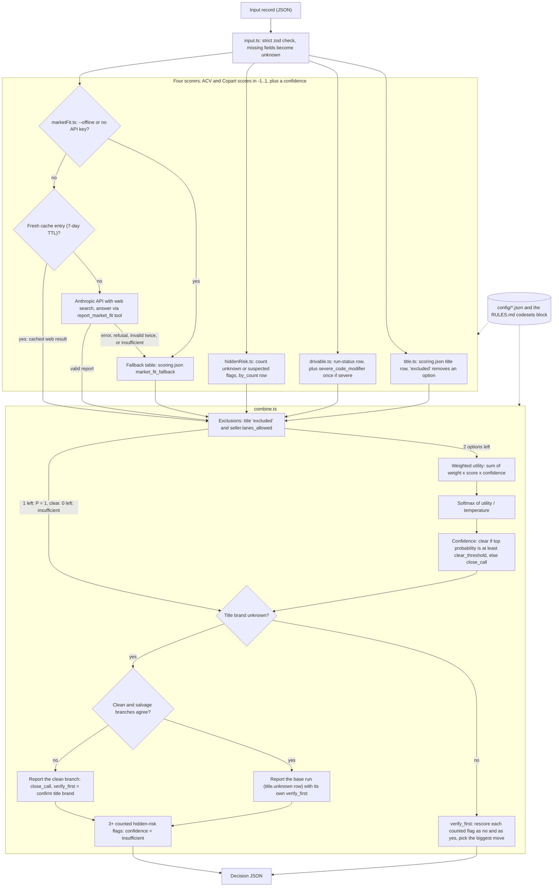

# Underscope engine v1: ACV vs Copart

## What it does

1. It reads one JSON record of a damaged vehicle: title, run status, five hidden-risk flags, scanner codes and seller lanes.
2. It scores two sale options, ACV (dealer wholesale) and Copart (as-is salvage), in four categories: title, drivable, hidden_risk and market_fit. Each score runs from -1 to +1 and has a confidence.
3. market_fit comes from one Anthropic API call with web search, cached for 7 days. It uses a fallback table when the engine runs offline, has no key, the call fails, or the search finds too little.
4. The combiner applies hard exclusions, sums weight x score x confidence for each option, and turns the two sums into probabilities with a softmax.
5. It returns a Decision: a recommendation, probabilities, a confidence (clear, close_call or insufficient), the one thing to verify first, and reasons and risks built from the numbers.

Repair costs and the fix-then-sell option are not in v1 (see [Where repair costs and fix-then-sell plug in](#where-repair-costs-and-fix-then-sell-plug-in)).

## Setup and commands

Node 22 and pnpm 9. Install once from the repo root:

```sh
pnpm install
```

Run these from `packages/engine`:

```sh
pnpm typecheck
pnpm test                                    # vitest, fully offline, no API key needed
pnpm -s engine decide  <file.json> [--offline] [--as-of <year>]   # Decision JSON
pnpm -s engine explain <file.json> [--offline] [--as-of <year>]   # contribution table
pnpm -s engine market  <file.json> [--offline] [--as-of <year>]   # market-fit result only
pnpm -s engine eval [--offline]              # all examples/*.json vs their .expected.md
pnpm -s engine samples ../../sample_vehicles.json [--use-shipped-config]
```

The repo root `package.json` forwards `pnpm engine ...` to this package, so the same commands work from the root (for example `pnpm -s engine samples sample_vehicles.json`).

- Use `-s`. Without it, pnpm prints its script banner to stdout before the output, so `pnpm engine decide ... > out.json` is not valid JSON. The engine's own logs go to stderr.
- A file argument is looked up relative to the directory where you ran pnpm, then the current directory, then `packages/engine`. A `*` in the file name is expanded and must match exactly one file. Quote it so your shell does not expand it: `pnpm -s engine explain 'examples/03_*.json' --offline`.
- `--offline` never calls the API. Market fit then uses the fallback table.
- `--as-of <year>` is the year used to compute vehicle age for the fallback table. The default is the current calendar year. The examples are pinned to 2026, so pass `--as-of 2026` to reproduce their expected answers with `decide` or `explain`. `eval` reads the year from each `.expected.md`. `samples` takes the year from the file's `generated` date and rejects `--as-of`.
- Exit code 1 on input, config or usage errors (the message goes to stderr), on any `eval` FAIL, and on any `samples` FAIL in the default mode.

### Live market fit

Put the key in a `.env` file, either at the repo root or in `packages/engine` (`.env.example` at the repo root shows the line):

```
ANTHROPIC_API_KEY=sk-ant-...
```

- A variable already set in the shell wins over `packages/engine/.env`, which wins over the repo-root `.env`. An empty key counts as missing. A `.env` that exists but cannot be read is skipped with a warning. `.env` is git-ignored.
- With a key and without `--offline`, `decide`, `explain`, `market` and `eval` make one market-fit call per vehicle profile (retried once if the answer is missing or invalid). A fresh cache entry means no call.
- Each API request logs its tokens, web searches and cost in USD to stderr. `eval` prints the total API cost of the run.
- The cache lives in `packages/engine/.cache/market` (git-ignored; override with `MARKET_CACHE_DIR`). The key is year, make, model, trim, odometer band (25,000-mile buckets), title brand and run status. Entries expire after 7 days. Only API results are stored, including "insufficient" ones so a thin-data profile is not billed again. Fallbacks are never stored.
- Other environment variables: `MARKET_MODEL` (default `claude-sonnet-5-5`), `MARKET_TIMEOUT_MS` (per-request timeout, default 300000), `UNDERSCOPE_RULES_PATH` (see [Code sets](#code-sets-rulesmd-and-codesetsjson)).

## How it works



### The four scorers

| Category | File | How it scores |
| --- | --- | --- |
| title | `src/title.ts` | Row `scoring.json` `title.<brand>`. A value `"excluded"` removes that option (its score is reported as 0). |
| drivable | `src/drivable.ts` | Row `drivable.<runs_drives>`. If the record is severe, `severe_code_modifier` is added once, then each score is clamped to [-1, 1]. Severe means: a `severe_when` entry holds on confirmed codes, or `flags.frame` is `"yes"`, or `flags.airbag` is `"yes"`. Pending and history codes never count. |
| hidden_risk | `src/hiddenRisk.ts` | Counts the flags in `hidden_risk.counts` whose value is in `count_as_risk` (`unknown`, `suspected`), then looks up `by_count` `"0"`, `"1"`, `"2"` or `"3+"`. A `"yes"` is a disclosed problem, not a hidden one, so it never counts here. The counted flags are the verify_first candidates. |
| market_fit | `src/marketFit.ts` | Web, cache or fallback (below). |

Market fit sends only year, make, model, trim, odometer, location state, title brand and run status. It never sends the VIN, flags or codes. The prompt is `prompts/market_fit.md`. The model must answer through a strict custom tool, `report_market_fit`, with `{acv, copart, confidence, signals, insufficient}`. The engine checks the answer with zod. An out-of-range score is invalid: it retries once, then falls back. Signals without an http(s) URL are dropped, and at most five are kept. Only the model's acv, copart and confidence numbers enter the Decision. Prices may appear only in signal text.

The fallback is used for `--offline`, a missing key, an API error, a refusal, a run where every web search failed, invalid output twice, an "insufficient" answer, or a turn that paused after 5 web searches. The fallback rows are tried in file order. The first rule that holds wins, else the `otherwise` row. Rules see `age_years` (as-of year minus model year) and `odometer`. A comparison on an unknown value is false. Fallback confidence is 0.4 and the source is `"fallback"`.

### The combiner

1. **Exclusions.** An option is removed when a scorer excludes it or when it is not in `seller.lanes_allowed`. A missing `lanes_allowed` allows both; `[]` allows neither. With one option left, it is the answer with P = 1, confidence "clear", and the exclusion as the first reason. With none left, the recommendation is null, both probabilities are 0, and confidence is "insufficient".
2. **Utility.** `utility(option) = sum over categories of weight x score x confidence`.
3. **Probabilities.** `softmax(utility / temperature)` over the two options, reported to 4 decimals.
4. **Confidence.** "clear" when the top probability, as reported, is at least `clear_threshold`; "close_call" otherwise.
5. **Unknown title.** See [User decisions](#user-decisions) below.
6. **Insufficient override.** When the title brand is unknown and 3 or more hidden-risk flags are counted, confidence becomes "insufficient". The recommendation and probabilities are still reported.
7. **verify_first.** For each counted flag, the decision is rescored with the flag set to `"no"` and to `"yes"` (same market result). The flag that moves the recommended option's probability most wins. Ties go to the earlier flag in this order: frame, airbag, flood, module_no_comm, monitors_incomplete. It is null when nothing moves the probability, for example when one option is excluded.
8. **Reasons and risks.** Three reasons: the categories with the largest contribution to the recommended option, with the exclusion first when an exclusion decided the answer. Two risks: the unresolved flags, and the losing option's strongest category (or why it is not available).

## Decision JSON

| Field | Meaning |
| --- | --- |
| `recommendation` | `"acv"`, `"copart"`, or `null` when no option is eligible |
| `probabilities` | `{acv, copart}`, 4 decimals, sum to 1 (both 0 when no option is eligible) |
| `confidence` | `"clear"`, `"close_call"` or `"insufficient"` |
| `verify_first` | a flag name, `"confirm title brand"`, or `null` |
| `category_scores` | for each category: `acv`, `copart`, `confidence`, `factors`, `source` (`input`, `web`, `cache`, `fallback`) |
| `reasons` | exactly 3 strings |
| `risks` | exactly 2 strings |
| `market_signals` | `[{claim, url}]` from the web analysis; `[]` for the fallback |
| `weights_version` | `version` from `config/weights.json` |
| `excluded` | `[{option, reason}]` for each removed option |

Example 3 (`pnpm -s engine decide 'examples/03_*.json' --offline --as-of 2026`). The real output has all four categories; three are left out here.

```json
{
  "recommendation": "acv",
  "probabilities": { "acv": 0.7427, "copart": 0.2573 },
  "confidence": "clear",
  "verify_first": "frame",
  "category_scores": {
    "drivable": {
      "acv": 0.4,
      "copart": 0.1,
      "confidence": 1,
      "factors": [
        "Run status: run_and_drive",
        "Severe: MISFIRE+CATALYST confirmed (P0301, P0420) -> modifier applied once"
      ],
      "source": "input"
    }
  },
  "reasons": [
    "title +0.350 for ACV: Title brand: clean",
    "market_fit +0.080 for ACV: Fallback table row \"late_low_miles\" (age 5 yr, 62,000 mi; rule: age_years <= 6 and odometer < 100000)",
    "drivable +0.060 for ACV: Run status: run_and_drive"
  ],
  "risks": [
    "Unresolved: frame (unknown)",
    "Copart's strongest case: hidden_risk +0.050: frame: unknown"
  ],
  "market_signals": [],
  "weights_version": 0,
  "excluded": []
}
```

## How to change weights and scoring

All numbers live in JSON. `loadConfig()` in `src/config.ts` reads and validates `config/*.json` on every run, so an edit takes effect on the next command. There is no build step. An invalid file stops the run with `Error: Invalid <path>: <field>: <problem>` and exit code 1. Scores must be in [-1, 1] and confidences in [0, 1].

| File | Key | What it does |
| --- | --- | --- |
| `weights.json` | `weights.title`, `.drivable`, `.hidden_risk`, `.market_fit` | Category weights in the utility sum. Each must be >= 0. The shipped ones sum to 1. |
| `weights.json` | `temperature` | Softmax temperature. Lower makes the probabilities more extreme. Must be > 0. |
| `weights.json` | `clear_threshold` | Top probability needed for "clear". Must be above 0.5 and at most 1. |
| `weights.json` | `version` | Copied into `Decision.weights_version`. Bump it when you change any number. |
| `scoring.json` | `title.<brand>` | `{acv, copart, confidence?}` per brand: clean, rebuilt, salvage, nonrepairable, unknown. `"excluded"` removes the option. |
| `scoring.json` | `drivable.<status>` | Rows for run_and_drive, engine_starts, no, unknown. |
| `scoring.json` | `drivable.severe_code_modifier` | `{acv, copart}` added once when the record is severe. |
| `scoring.json` | `hidden_risk.counts` | Which flags can count as hidden risk. |
| `scoring.json` | `hidden_risk.count_as_risk` | Which flag values count (`unknown`, `suspected`). |
| `scoring.json` | `hidden_risk.by_count` | Rows for 0, 1, 2 and 3+ counted flags. |
| `scoring.json` | `market_fit_fallback.<row>` | `{rule, acv, copart}`. A rule compares `age_years` or `odometer` with a number (`<`, `<=`, `>`, `>=`, `==`, `!=`), joined by `and` / `or`. Exactly one row must use `"otherwise"`. Rules are checked when the config loads. |
| `scoring.json` | `market_fit_fallback.confidence` | Confidence of every fallback row. |
| `codesets.json` | `<SET_NAME>` | Lists of codes. A same-named list in RULES.md replaces it (below). |
| `codesets.json` | `severe_when` | Entries such as `"MISFIRE+CATALYST"`: every named set must have a confirmed code. A single name (`"TRANSMISSION"`) needs one. |
| `prompts/market_fit.md` | whole file | The market-fit prompt. Placeholders: year, make, model, trim, odometer, location_state, title_brand, run_status. |

A row's `confidence` defaults to 1.0 when the row does not set it.

After a change, run `pnpm -s engine eval --offline` and `pnpm test`. The examples' `.expected.md` files and the tests were computed by hand from the shipped numbers, so they will report every answer that moved. Update them on purpose; do not tune numbers to make them pass.

A few numbers are constants in the TypeScript source, not JSON: the cache TTL and odometer band (`src/cache.ts`), and the token prices, web-search price, search and retry caps and default timeout (`src/marketFit.ts`). `tsx` runs the source directly, so these need no build step either, but some tests pin them.

### Code sets: RULES.md and codesets.json

The code lists come from the fenced `yaml codesets` block in RULES.md. That block is the only part of RULES.md the engine reads. Each line looks like `MISFIRE: [P0300, P0301]  # comment`. A list there replaces the list with the same name in `codesets.json`. Lists that RULES.md does not name stay as in `codesets.json`. `severe_when` always comes from `codesets.json`. A `severe_when` name that matches no list is a config error.

`findRulesMd()` in `src/config.ts` picks the file in this order:

1. `$UNDERSCOPE_RULES_PATH`. A relative path is tried from the directory where you ran pnpm, then the current directory. `""` or `none` turns RULES.md off. A path to a missing file is an error.
2. `packages/engine/rules/rules.md` (the location the build spec names).
3. `RULES.md` or `rules.md` in `packages/engine` and each parent up to the repo root, the first directory with `pnpm-workspace.yaml` or `.git`. It never looks above the repo root. Without a repo root, only `packages/engine` is searched.

Today that is the repo-root `RULES.md`. It supplies all four sets and has more codes than `codesets.json` (MISFIRE adds P0309-P0312; SRS_DEPLOYMENT adds B0004, B0005, B0013, B0014). The footer of `explain` prints where each set came from.

## Starting guesses, not calibrated

Every number below is a hand-set starting guess. None has been fitted to real sale outcomes. The examples and the sample check show that the engine applies the numbers as written, not that the numbers are right.

- All of `config/scoring.json`: title, drivable and hidden-risk rows, `severe_code_modifier`, the row confidences (title.unknown 0.3, drivable.unknown 0.4).
- All of `config/weights.json`: the four weights, `temperature` 0.5, `clear_threshold` 0.70.
- The market-fit fallback: the three rules (6 years, 10 years, 100,000 and 150,000 miles), their scores and confidence 0.4.
- The code lists in `codesets.json` and in RULES.md (RULES.md marks SRS_DEPLOYMENT and TRANSMISSION as PLACEHOLDER), and the `severe_when` combinations.
- The cache odometer band (25,000 miles) and TTL (7 days) in `src/cache.ts`.
- The pricing constants in `src/marketFit.ts` (`PRICES_PER_MTOK`, `USD_PER_WEB_SEARCH`), copied from the pricing page on 2026-11-07. Update them by hand when prices change. A model missing from the table is costed at $0 for tokens, with a warning.
- The market-fit limits in `src/marketFit.ts`: at most 5 web searches per attempt, 5 signals kept, 2 attempts, 3 pause_turn continuations, 16,000 max tokens (21,000 on a retry after a cut-off), a 5-minute request timeout and one SDK retry.

## Where repair costs and fix-then-sell plug in

See the `TODO(v2)` comment at the top of `src/combine.ts`.

- **Repair cost** becomes a new category. Add it to `CATEGORIES` in `src/types.ts`, call its scorer from `scoreCategories()` in `src/combine.ts`, and give it a weight in `config/weights.json` (the weights schema is built from `CATEGORIES`).
- **Fix-then-sell** becomes a new option. The option side is still two-way, so it touches: `OPTIONS` (`src/types.ts`) and `OPTION_LABEL` (`src/combine.ts`); `Decision.probabilities`; an n-way `softmax()` and argmax in `evaluate()`; the one-eligible probabilities and `reportedProbabilities()`; `otherOption()` and the single loser in `buildReasons()` / `buildRisks()` (`src/explain.ts`); a new column in every `scoring.json` row plus the row schemas in `src/config.ts`; and the explain table columns.
- The TODO does not list it, but market fit is two-way too: the `report_market_fit` tool schema and `ReportSchema` in `src/marketFit.ts`, the cached `AnalysisSchema` in `src/cache.ts`, and `prompts/market_fit.md` only know ACV and Copart.

## User decisions

### Example 3 stays "clear"

The spec says example 3 (clean title, runs, 2021, 62,000 miles, MISFIRE and CATALYST confirmed, frame unknown) should be a close call. Under the shipped config it gives U_ACV 0.490, U_Copart -0.040 and P(ACV) = 0.7427, which is at least 0.70, so the rule says "clear". The user chose to keep the config and the record as written. `examples/03_*.expected.md` therefore expects ACV, clear, verify_first frame, and `explain` prints `Confidence: clear` and `verify_first: frame`. The spec acceptance line that asks for "close_call" here does not hold, by that decision.

### Unknown title

When the title brand is `"unknown"` or missing:

1. The **base run** is the normal decision on the record as it is, so the title category uses the `title.unknown` row (0 / 0, confidence 0.3). It has its own probabilities, confidence and verify_first.
2. The record is also scored with the brand set to clean and to salvage. All three runs reuse the one market-fit result, so there are no extra API calls.
3. If the clean and salvage branches recommend the same option, the base run is returned.
4. If they disagree, the clean branch is returned with confidence "close_call" and verify_first "confirm title brand".
5. The insufficient override (3+ counted flags) applies to whichever decision is returned.

The first title factor says which case applied, for example "Title brand unknown: clean branch -> acv, salvage branch -> copart; reported the clean branch". When the clean branch is reported, the title row's source in `explain` reads "input, assumed clean (title unknown)". Example 6 is example 2 with an unknown title: the branches disagree, so it returns ACV, P(ACV) 0.8334, close_call, "confirm title brand".

## sample_vehicles.json check

The user's file `sample_vehicles.json` at the repo root holds 15 records. Each has an `expected_offline` answer computed under the file's own `config_used`: weights version 1 (title 0.30, drivable 0.25, hidden_risk 0.25, market_fit 0.20, temperature 0.5, clear_threshold 0.7) and `drivable.severe_code_modifier` ACV -1.0 / Copart +0.4. The user chose to keep the shipped config at version 0, so the file is checked under its own config, never by editing `config/`.

```sh
pnpm -s engine samples ../../sample_vehicles.json                       # 15/15 PASS
pnpm -s engine samples ../../sample_vehicles.json --use-shipped-config  # 7/15 match, informational
```

- The default mode builds the file's config in memory (`src/samples.ts`): `config/` plus the overrides. A `"weights"` object or `"weights.<field>"` key sets a `weights.json` field, a dotted key replaces that path in `scoring.json`, and `"note"` is ignored. Any other key is an error. Code sets stay as shipped.
- Every record runs offline with the fallback market fit, as of the year of the file's `generated` date (2026). Probabilities are compared within 0.006 because the file rounds them to 2 decimals. Recommendation, confidence and verify_first must match exactly.
- `--use-shipped-config` runs under `config/` as shipped and reports the differences. It always exits 0.
- `test/samples.test.ts` runs the same check, including v14 (branches agree on Copart: P(ACV) 0.29, insufficient, frame) and v09 (branches disagree: P(ACV) 0.83, close_call, "confirm title brand").

## RULES.md alignment

RULES.md is the team rule book. This engine reads only its `yaml codesets` block.

What the engine follows:

- Code sets from the `yaml codesets` block, found as described in [Code sets](#code-sets-rulesmd-and-codesetsjson). The lookup stops at the repo root, so a RULES.md in an enclosing checkout cannot change the inputs. `test/config.test.ts` covers the order, the repo-root limit and `UNDERSCOPE_RULES_PATH`.
- "A code set fires only on confirmed codes" (section M): pending and history codes never make a record severe.
- T01 and T02: nonrepairable and salvage titles exclude ACV. The engine gets this from the `"excluded"` values in `scoring.json`, not from the T rules.
- S01: an option not in `seller.lanes_allowed` is excluded; a missing list allows both.
- Disclosed versus unknown (section H): a flag set to `"yes"` is disclosed and is not hidden risk. Frame or airbag `"yes"` moves drivable instead.
- The `branch` effect, for the title brand only: score each value, and if the answers disagree, verify the title first.
- D01 in effect: with two options, "top probability at least 0.70" is the same as p_win at least 0.70 or at most 0.30. The number comes from `weights.json` `clear_threshold`, not from the RULES.md `params` block.

What it does not implement yet:

- The `yaml rule` blocks and the `yaml params` block. There is no rule parser and no `rules_fired` evidence. The `rules.ts` and `decide.ts` files that RULES.md names do not exist here.
- Guards G01 and G02. `vin` is optional and nothing blocks a record without a VIN or a decoded model. Even `{}` gets a decision: ACV, P(ACV) 0.5175, insufficient, "confirm title brand".
- Checking codes against `inputs/codes/dtc_standard.csv`. Codes only need the OBD-II shape (for example `P0301`). RULES.md's `status_weight` (pending 0.5, history 0.1) is not used; those codes count as 0.
- Price bands and every dollar effect: deductions, repair cost (R), the fix option, ACV dispute cost (H01, H02), red light (M10), inspection skip (M11), Copart buyer segments, export, parts donors and the uncertainty discount (F06-F10), days to cash, and the objective switch (S06).
- D02 as written. RULES.md says "insufficient" means more than 2 high-cost unknowns in dollars. The engine uses title unknown and 3+ counted flags, or no eligible option.
- D03 as written. RULES.md flips simulation samples and breaks ties structural > title > safety > mechanical > market. The engine uses probability movement and the flag order frame > airbag > flood > module_no_comm > monitors_incomplete. The title is checked only through branching.
- Section H is ACV-only in RULES.md. Here hidden_risk scores both options (the `by_count` rows give Copart up to +0.6).
- The new ConditionRecord fields (`title.in_hand`, `title.lien`, `damage[]`, `modules[]`, `seller.repair_capability` and others) and Decision fields (`acv_light`, `p_no_sale_acv`, `skip_acv_inspection`, `best_copart_segment`, `gaps`). The input schema is strict, so a record that carries those fields today is rejected.

## Known limits

- **The live API path has never run against the real API.** The strict custom tool `report_market_fit` with `tool_choice: auto`, together with the `web_search_20260209` server tool on `claude-sonnet-5-5`, is tested only with a fake client. The spec acceptance line "with a key, `market examples/02_*.json` prints signals with source URLs" is unverified.
- **A stalled API endpoint is slow to give up.** Each request has a 5-minute timeout (`MARKET_TIMEOUT_MS`) and one SDK retry, so one vehicle can wait about 10 minutes before the fallback. Nothing is printed while it waits. `eval` runs six examples in turn. Use `--offline` or a smaller `MARKET_TIMEOUT_MS` when that matters.
- **Input checks are shape checks.** Unknown or misspelled keys (for example `runs_drive`) are an error, and absent keys become `"unknown"`. A record that is mostly missing still gets a decision. `location_state` only has to be two letters, so `"ZZ"` is accepted. Missing title and run status are marked "(missing)" in the factors; a missing flag shows only as "unknown".
- **Answers depend on the year.** Without `--as-of`, vehicle age uses the current year, so fallback rows (and the answers) for the same record can change on 1 January.
- Input, sample and config files may start with a UTF-8 byte-order mark (files saved by Windows editors).
